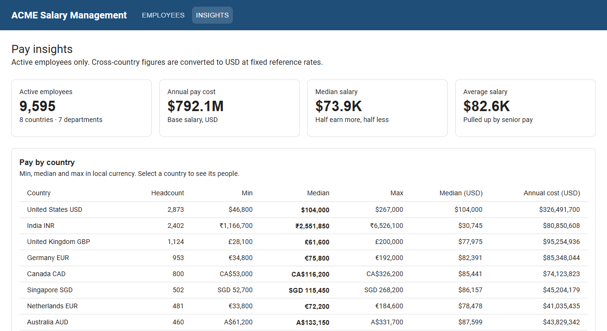
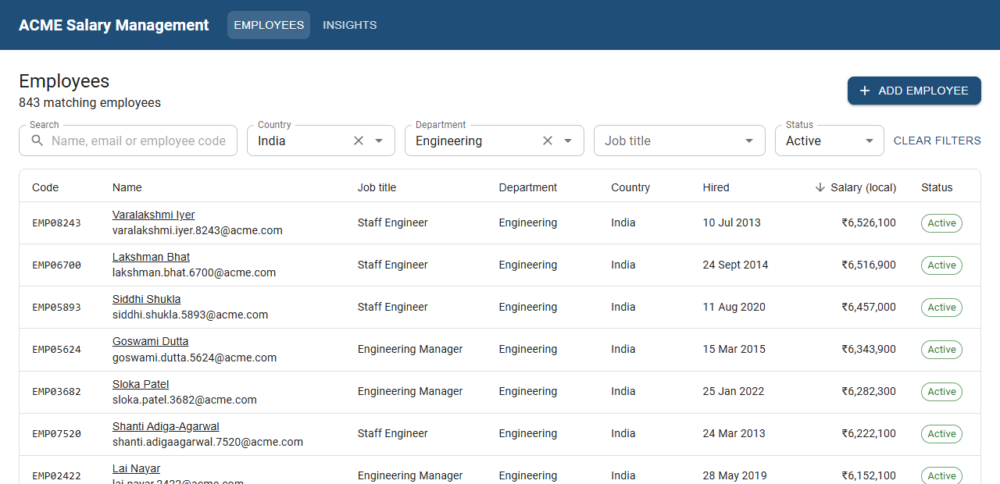
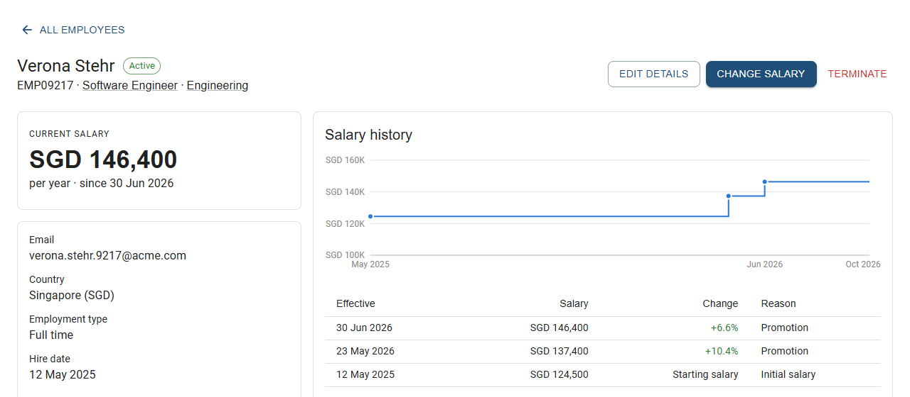

# ACME Salary Management

A web app for ACME's HR manager to manage salary data for **10,000 employees across 8 countries**, replacing spreadsheets, and to answer the question _"how does the organisation pay people?"_.

> **Live demo:** [acme-salary-management-smr3.onrender.com](https://acme-salary-management-smr3.onrender.com) · **Video walkthrough:** [Google Drive recording](https://drive.google.com/file/d/1uKYZS3lDUN84_c9E9JoGSZoQcQRY0HpS/view?usp=drive_link)
>
> Hosted on a free plan: after 15 minutes without visitors the app sleeps, and the first visit takes about a minute to wake it.



## What it does

**Manage employees and salaries**

- Find anyone among 10,000 employees with server-side **search** (name, email or employee code), **filters** (country, department, job title, status), **sorting** and **pagination**. The list state lives in the URL, so a filtered view can be bookmarked or shared.
- **Add, edit and terminate** employees. Termination is a soft delete, so records and history are kept for reporting.
- **Change a salary** with an effective date and a reason. Every change is recorded in an append-only **salary history**, shown as a table and a salary-over-time chart. Changes over ±30% need an explicit confirmation, so typos are caught before they are saved.

**Understand pay**

- Headline figures: active headcount, annual pay cost, median and average salary.
- Pay by **country** (in local currency, with USD comparisons), by **department** and by **job title**, with min, median, average and max, plus a **salary distribution** and **recent changes**.
- Pick a country to see its pay bands in local currency.
- Every country, department and job title **links to the matching employees**, so you can go from a number to the people behind it.

| Employee directory                               | Employee with salary history                         |
| ------------------------------------------------ | ---------------------------------------------------- |
|  |  |

## Quick start

Requires **Node.js 20+**.

```bash
npm install                            # installs both workspaces and generates the Prisma client
cp server/.env.example server/.env     # SQLite file path and API port
npm run db:migrate                     # creates the database schema
npm run seed                           # loads 10,000 employees and ~16,000 salary revisions (~2 s)
npm run dev                            # API on http://localhost:3000, app on http://localhost:5173
```

Open **http://localhost:5173**. The seed is deterministic, so every machine gets the same data. Re-running `npm run seed` resets the database to it.

| Command                                       | What it does                           |
| --------------------------------------------- | -------------------------------------- |
| `npm test`                                    | All server and client tests            |
| `npm run lint` / `typecheck` / `format:check` | Static checks (the same steps CI runs) |
| `npm run build`                               | Production build of client and server  |
| `npm run db:studio`                           | Browse the database in Prisma Studio   |

## How it is built

| Layer    | Choice                                                                             |
| -------- | ---------------------------------------------------------------------------------- |
| Backend  | Node.js, TypeScript, Express 5, Zod validation                                     |
| Database | SQLite through Prisma 6 (migrations, typed queries; raw SQL only for aggregations) |
| Frontend | React 19, Vite, MUI 9, TanStack Query, React Router 7, Recharts                    |
| Tests    | Vitest, Supertest (API against a temporary SQLite database), React Testing Library |
| CI       | GitHub Actions: lint, format check, typecheck, tests, build on every push          |

The server is layered: **routes** parse and validate requests, **services** hold the business rules, and **repositories** are the only code that talks to the database. All filtering, sorting, paging and pay analytics run **in SQL**: the client never downloads the full employee list, and no endpoint loads individual salaries into Node to compute statistics.

```
server/
  prisma/        schema and migrations
  src/
    domain/      countries, FX rates, histogram buckets, clock (pure, no I/O)
    validation/  Zod request schemas
    routes/      Express routers
    services/    business rules (employees, salary changes, insights)
    repositories/ the only code that touches Prisma
    http/        response mapping and the central error handler
    seed/        deterministic 10k-employee generator and seed script
  tests/         API, service and domain tests
client/src/
  api/           typed fetch client and endpoint functions
  hooks/         TanStack Query hooks (queries, mutations, cache invalidation)
  features/      employees (list, detail, dialogs) and insights (dashboard)
  components/    layout, charts, page states, shared controls
docs/            requirements, architecture, decisions and more (below)
```

## Deployment

The app runs as **one web service** on [Render](https://render.com) (free plan): Express serves both the API and the built React app on a single URL. The database is [Turso](https://turso.tech), hosted SQLite, because free Render services have no persistent disk. Both run in the same region (Oregon). The reasoning is in [ADR-010](docs/decisions.md).

- **Blueprint:** [`render.yaml`](render.yaml) in the repository root defines the service: build command, start command, health check (`/api/health`) and environment variables.
- **On every start:** pending migrations are applied, the 10,000-employee seed runs **only if the database is empty** (so restarts keep HR's changes), and then the server starts.
- **Secrets:** `TURSO_DATABASE_URL` and `TURSO_AUTH_TOKEN` are entered in the Render dashboard and never committed. Without them the app uses the local SQLite file, which is how development and tests run.
- **Free-plan note:** the service sleeps after 15 minutes without traffic, so the first visit after a quiet period takes about a minute to wake it.

To rehearse production locally:

```bash
npm run build
TURSO_DATABASE_URL="file:./prod-rehearsal.db" npm start   # migrate, seed if empty, serve on :3000
```

## Testing

**130 server tests** (~3.5 s) and **61 client tests**, all fast and deterministic: the seed uses a fixed random seed, date rules use an injected clock, and API tests run against a fresh temporary SQLite database for each test file.

- Business rules and pay statistics are checked against small datasets with **expected values worked out by hand**.
- Core logic was written **test-first**, and the important tests were **mutation-checked**: each rule was broken on purpose to confirm a test fails.

## Documentation

| Document                                                                         | What it covers                                                         |
| -------------------------------------------------------------------------------- | ---------------------------------------------------------------------- |
| [Requirements](docs/requirements.md)                                             | Goal, scope, business rules, and what is deliberately left out and why |
| [Architecture](docs/architecture.md)                                             | System design, data model, API and testing strategy                    |
| [Decisions](docs/decisions.md)                                                   | Architecture decision records (ADR-001 to ADR-010)                     |
| [Trade-offs and future improvements](docs/trade-offs-and-future-improvements.md) | What this version gives up, known limitations, and what comes next     |
| [Performance](docs/performance.md)                                               | Query timings on 10k rows, bundle size, and the scale-up path          |
| [AI usage](docs/ai-usage.md)                                                     | How AI tools were used, what was corrected, and how output was checked |

## Scope at a glance

**In:** employee management, salary changes with history, multi-currency pay insights, a 10k-employee seed.
**Deliberately out:** payroll and net pay, authentication, live FX rates, Excel import/export. The reasons are in the [requirements](docs/requirements.md), and the plan for each is in [future improvements](docs/trade-offs-and-future-improvements.md).
