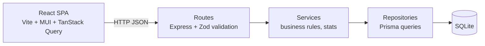
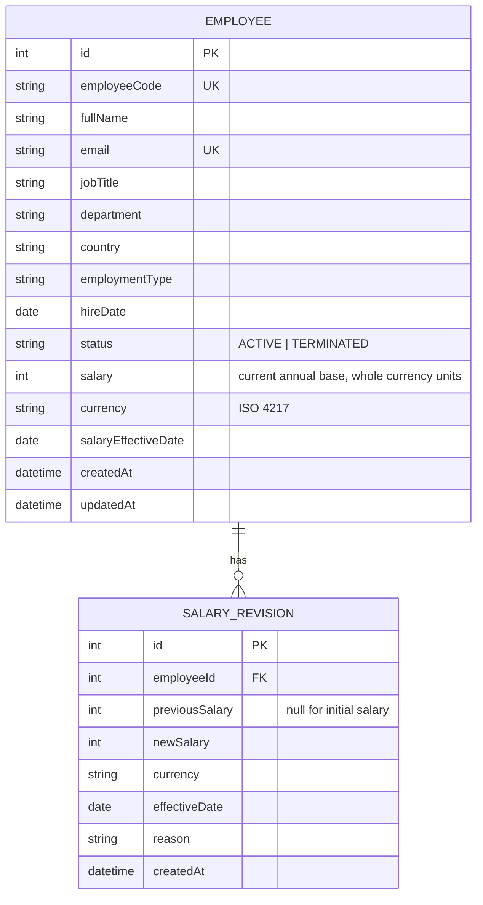

# Architecture & Design

## Overview

A single deployable TypeScript application. An Express API serves both `/api/*` and the built React client, which gives one URL with no CORS to configure.



| Layer        | Responsibility                                                        | Depends on            |
| ------------ | --------------------------------------------------------------------- | --------------------- |
| Routes       | HTTP concerns: parse and validate input (Zod), map to status codes    | Services              |
| Services     | Business rules: salary change plus revision, analytics, FX conversion | Repository interfaces |
| Repositories | The only layer that talks to the DB (Prisma)                          | Prisma client         |
| Domain       | Pure functions and types: money, stats (median, percentiles), FX      | Nothing               |

Services receive repositories (and a clock) through constructor injection. Unit tests can therefore use in-memory fakes, and integration tests can use a throwaway SQLite file.

## Repository layout

```
/docs                 requirements, architecture, decisions, ai-usage, performance
/server
  prisma/             schema.prisma, migrations, seed.ts
  src/
    domain/           money.ts, stats.ts, fx.ts
    repositories/
    services/
    routes/
    validation/       zod schemas
    app.ts            express app factory (no listen; easy to test)
    index.ts          bootstrap
  tests/
/client
  src/{api,components,pages,hooks}
```

npm workspaces (`server`, `client`) are driven by root scripts: `dev`, `test`, `lint`, `typecheck`, `seed`, `build`.

## Data model



**Current salary lives on the employee row.** This is the most common read: list views and aggregations need it with no join. The revision table is append-only history. Both are written in a single transaction.

**Indexes:** `country`, `department`, `jobTitle`, `status`, `(country, department)`, `fullName`, plus unique `email` and `employeeCode`.

FX rates to USD are a static constant in `domain/fx.ts` (for example INR, GBP, EUR, USD, CAD, SGD, AUD, JPY).

## API

| Method | Path                                                                                    | Purpose                                                                     |
| ------ | --------------------------------------------------------------------------------------- | --------------------------------------------------------------------------- |
| GET    | `/api/health`                                                                           | Liveness                                                                    |
| GET    | `/api/employees?page&pageSize&search&country&department&jobTitle&status&sortBy&sortDir` | Paginated list. `pageSize` ≤ 100. Returns `{ data, page, pageSize, total }` |
| GET    | `/api/employees/:id`                                                                    | Employee with salary revisions                                              |
| POST   | `/api/employees`                                                                        | Create (creates the initial revision)                                       |
| PATCH  | `/api/employees/:id`                                                                    | Update non-salary fields                                                    |
| DELETE | `/api/employees/:id`                                                                    | Soft terminate                                                              |
| POST   | `/api/employees/:id/salary`                                                             | `{ salary, effectiveDate, reason }`. Records a revision.                    |
| GET    | `/api/meta/filters`                                                                     | Distinct countries / departments / job titles for dropdowns                 |
| GET    | `/api/insights/summary`                                                                 | Headcount, total annual cost (USD), median (USD)                            |
| GET    | `/api/insights/by-country`                                                              | Per country: headcount, min/max/avg/median (local + USD)                    |
| GET    | `/api/insights/by-department`                                                           | Per department: headcount, total cost (USD), median (USD)                   |
| GET    | `/api/insights/by-job-title?country=`                                                   | Per title: min/max/avg/median                                               |
| GET    | `/api/insights/distribution?country=`                                                   | Salary band histogram                                                       |
| GET    | `/api/insights/recent-changes?limit=`                                                   | Latest revisions                                                            |

**Error shape:** `{ "error": { "code": "VALIDATION_ERROR", "message": "...", "details": [...] } }`. The status codes used are 400 (validation), 404 (not found), 409 (unique conflict) and 500 (unexpected).

## Key decisions (summary — reasoning in `decisions.md` as they are made)

1. **Offset pagination.** At 10k rows offset is cheap and supports "jump to page N". Keyset pagination is the upgrade path.
2. **Search with `LIKE`** on indexed columns, debounced on the client. SQLite FTS5 is the upgrade path.
3. **Aggregations in SQL** (`GROUP BY`). Median is computed per group from sorted values. Insights never load all rows into JS just to sum them.
4. **Money as whole-unit integers plus currency**, so there are no floating-point errors (see `decisions.md`, ADR-002).
5. **Append-only revisions** are written transactionally with the salary update.
6. **SQLite** is suggested by the brief and has zero ops. Prisma keeps a move to Postgres to a config change.
7. **Single deployable**: Express serves the static client build.

## Testing strategy

| Level           | Tooling                          | Covers                                                                                                            |
| --------------- | -------------------------------- | ----------------------------------------------------------------------------------------------------------------- |
| Unit            | Vitest                           | Domain (money, median/percentiles, FX), services with fake repositories, seed generator determinism               |
| API integration | Vitest + Supertest + temp SQLite | Pagination boundaries, filter combinations, validation errors, aggregations against a small hand-computed fixture |
| Component       | Vitest + React Testing Library   | Employee list filters, salary form validation, empty and error states                                             |

Rules: no network calls, an injected clock, a fixed faker seed, and the whole suite runs in seconds. Core services are built test-first.
